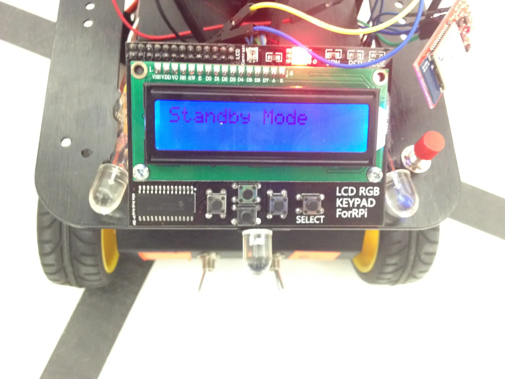
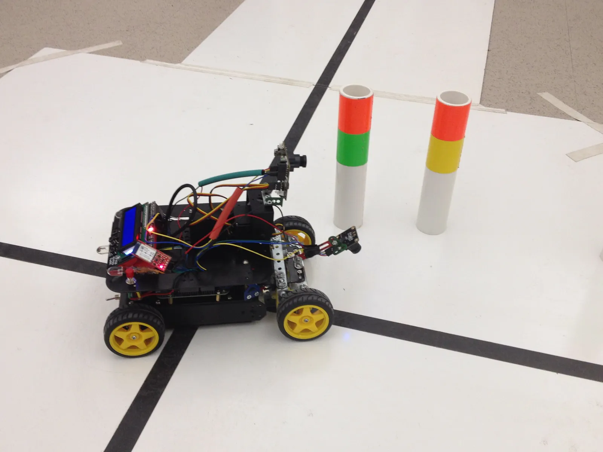

A small four-wheeled car that follows a black line around a track it has never seen, reads colored posts at each intersection to decide which way to turn, and stops itself at the finish line. No remotes, no maps, just two cameras and a microcontroller. Simple, right?

It was the semester-long project for EE416/464 (Senior Design Lab) at Clarkson University in fall 2015, built by a team of three that called itself "Straight Outta CompE". I wrote all of the software and firmware, and my teammate Juan did most of the wiring and built the steering brackets.

## The challenge

The car had to handle three modes, and the user (the professor) could pick any of them at any time from an LCD panel on the car.

- **Discovery.** Start anywhere within two feet of the track, facing any direction, find the line on its own, then finish the course.
- **Accuracy.** Two laps, staying as close to the line as possible, then stop at the start/stop line.
- **Speed.** Two laps, as fast as possible without losing the line.

In every mode, the car had to obey the posts placed *before* each intersection. Two posts with different colors meant turn left or right depending on their order. Two of one color meant go straight, and two of the other meant turn around.

## How it works

### Seeing the line
The line camera is a single row of 128 pixels pointed at the ground. A pair of hardware timers drive its pulse and clock lines, and every clock tick triggers an analog read through an interrupt. That means a full frame can arrive without the main loop doing anything. Each frame has its pixels thresholded into black and white, and the center of the first sequence of black pixels wide enough to be the line is taken as the line's position. A frame that's almost entirely "black" is an intersection, but *only* if the next frame agrees. This keeps one bad reading from sending the car into a turn. The start/stop line has its own pattern of separate stripes to tell it apart from an intersection.

### Reading the posts
The second camera is a CMUcam5 Pixy, trained to recognize the two post colors. The car polls for data over I²C every 20 milliseconds and decodes the raw blocks it sends back. Then it compares the colors and positions of the two posts it sees. The answer translates over to LED indicators, so you can see which way the car is planning to turn before it gets to the intersection. Aside from left and right, having both on means "forward" and both off means "turn around". It made debugging on the fly a lot easier.

### Hybrid steering
The chassis started out as a four-wheel-drive kit that turned by spinning its wheels at different speeds. We called this a "tank differential". We added a servo-steered front axle on brackets Juan built. But steering alone couldn't keep the car centered in tight curves. So the final design uses both approaches. One PID controller steers the servo from the line's position. When the steering hits its limit, two more PID controllers take over the left and right motors and turn the car with its wheels too. At an intersection where the posts indicate a turn, the car brakes, rolls forward a bit, and then spins in place until the camera finds the new line. How far it rolls depends on its speed. That makes sure the line camera is past the intersection and won't see it again during the turn.

### Its own hardware layer
Instead of leaning on the vendor's drivers for everything, I wrote my own layer over the Freedom K64F's timers, PWM, ADC, and GPIO. This allowed me to control every little detail and optimize to our needs. A [mid-semester snapshot](https://github.com/rauenzi/Senior-Design) of the code shows that the line camera, PID, and mode code sets registers directly in every file. In the final code I moved all of that into its own layer so everything else could be written in a more readable way. I split the rest of the code into modules. The line camera, the Pixy, the LCD, driving, and mode control each has its own file, with structs standing in for classes.

## What went wrong

It was *mostly* hardware that went wrong, and not because a part failed or a chip didn't work as described. It was more so about getting the hardware to work in our specific setup and environment. Some of that was definitely on us too, but as college students, I'll give us the benefit of the doubt.

### Noise
To keep the car compact, the H-bridges and power regulator sat inside the chassis next to the power distribution board. The motors' electrical noise got into the ground. This seemed to make the physical mode switches occasionally change modes on their own. Early on, in speed mode going fast down straightaways, the car would "blip" itself into discovery mode and start going in circles to re-find the line it was already on. We added filtering to the H-bridges later on, which cut back on the "blips", but it still bit us once in a while.

### Lighting
Ambient light changed how the line camera saw the track, especially in the early morning. Three bright white LEDs pointed along with the camera helped it tell black from white, but we still had to adjust the camera's angle depending on the time of day. This one might have been the most frustrating because the actual cause wasn't obvious. We had ruled out light levels as a factor since the lab itself was very well lit, but the windows to the outside affected the light level inside enough to matter.

### Understeer
The first version with steering could make the 90° turns at intersections but drifted off course around the curves and bends. It felt counterintuitive that the steering could handle the 90° turns but not the curves that were less than 90°. Ultimately, that's what inspired the hybrid steering.

### Tuning
All three PID controllers shared one scaling factor so we could sweep it from 0 to 2 in steps of 0.1 and keep whatever followed the line best. We first did this tuning in an "ideal" state with a small replicated section of track on our bench, under the desk lights. That meant our tuning was set for a brighter environment with less noise on the track. Putting that same scale factor down on the real test track could give wildly different results. We ended up making our isolated test on our workbench a bit more rugged to match the real test track. For both the bench tests and the real test track, logging the line position and the planned turn over serial made all of that a lot less guesswork.

In the end, the car passed every mode. In accuracy mode, it followed the line about 95% of the time and averaged around 1 minute and 10 seconds a lap.

Looking back at the code now, it's very much a student project. Timing is done with empty `for` loops, and the car blocks in tight `while` loops waiting for the camera to see the line again. But it's still the project where I first learned how much of embedded work is getting the real world to cooperate with the code.
