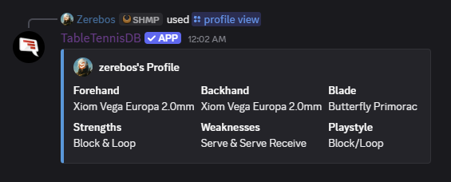
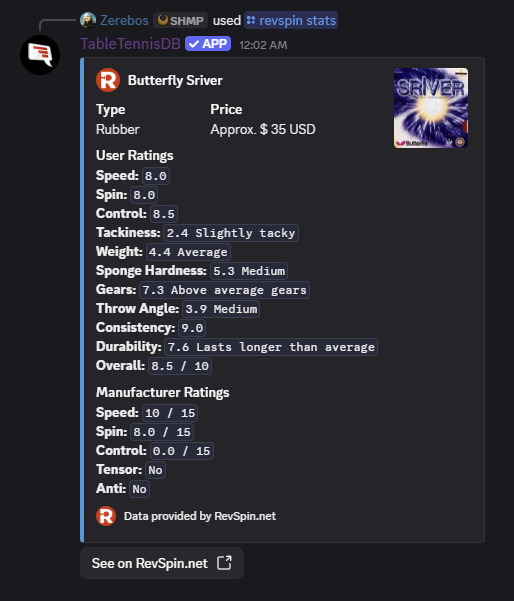

A Discord bot for table tennis players and enthusiasts. It looks up equipment ratings from [RevSpin](https://revspin.net), world rankings and the event calendar from the [ITTF](https://ittf.com), live results from World Table Tennis, and college ratings from the [NCTTA](https://nctta.com). It also keeps a profile of your own setup and playing style that you can share with anyone.

It's been running since 2017. In that time it's gone from Python to JavaScript to TypeScript, and from `!` commands to slash commands to something you can install on your own account, keeping up with how Discord bots work. But the work is never done, and there's always more I want to improve.

## Where it started

The first version was Python, built on [discordbot.py](https://github.com/zerebos/discordbot.py), my own wrapper around discord.py. It took its name from TableTennisDB.com, the equipment site it pulled ratings from. It could also page through the ITTF's world rankings, filtered by gender, age group, month, and year.

And yes, `!ping` replied "Pong!", but then immediately followed up with "Hey wait, it's called Table Tennis not ping pong." It was one of the first things that came to mind when I started building the bot.

## Rewrites

### 2020
Rewritten in JavaScript on [discord.js](https://discord.js.org) and its Commando framework. This is where personal profiles came in, and equipment lookups moved over to RevSpin, which is what TableTennisDB.com had become. The bot has outlived its namesake by years now. Like a lot of bots back then, it also picked up a bit of everything else: moderation, keyword reactions, and assignable roles.

### 2022
Discord's slash commands replaced the old `!` prefix, and the bot narrowed itself back down to table tennis. The general-purpose commands were dropped so it had a clear scope and didn't clash with dedicated moderation bots over the same slash command names. Profile editing moved into Discord's modal forms instead of a back-and-forth of messages. USATT and NCTTA ratings were added, along with a privacy policy and terms of service.

### 2024
The bot moved into a Docker container with its settings in environment variables, picked up a [World Table Tennis](https://worldtabletennis.com) module for live results, and got a fix for the ITTF calendar.

### 2025
Converted to TypeScript and [Bun](https://bun.sh), and made user-installable. You can add the bot to your own Discord account instead of a server, and use it in DMs or any server you're in, with the same profile everywhere.

## How it works

### Fuzzy equipment search
Nobody remembers *exactly* what a rubber is called. And even if they do, they can't always spell it correctly. So the bot keeps a cached list of every product in each of RevSpin's categories, and scores a search against all of them by string similarity. A search can start with a category, like `blade viscaria`, to narrow it down. If the best match scores high enough, it shows that product's ratings straight from its RevSpin page. Otherwise it shows the five closest matches and how well each one matched, so you can try again.

### Rankings from a guessed URL
The ITTF doesn't have a rankings API. It publishes each week's rankings as an HTML file at a predictable path, built from the year, the month, and the week number. The bot builds that URL for the current week, and if this week's file isn't up yet, it falls back to last week's.

### Living downstream of other people's websites
Almost everything the bot shows comes from someone else's site, so a redesign on their end breaks a command on mine. The ITTF has moved its rankings more than once, and the World Table Tennis results come from the same API their own site uses. The USATT went further and blocked the bot entirely. I made a few attempts to get around the blocks to no avail, and I even reached out to them asking about an official API. Unsurprisingly, they told me no. Sometimes you just have to live with the limits you're beholden to and present that honestly to your users. So now the USATT commands explain the issue instead of failing silently.
