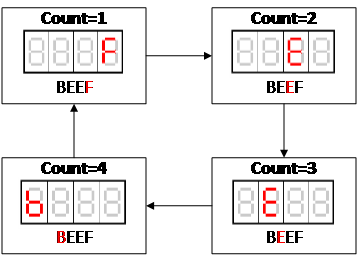

An FPGA counts through a short list of hex values once a second (`0000`, `0A0A`, `5050`, `FE45`, `AABB`, `CCDD`, `FEED`, `DEAD`, `BEEF`), showing each one on the board's own seven-segment displays. At the same time, it sends the same value to an external SparkFun serial display three different ways: TTL serial, SPI, and I²C. Three buttons allow you to reset the sequence, pause it, and reverse it.

It was the project for EE316 (Computer Engineering Junior Lab) at Clarkson University. It was meant to be a group project, but I ended up building the whole thing myself. I did try to work with my group mates for a while and be patient waiting for them to complete their tasks. But eventually, when they produced nothing, I had to step in and do the rest. It was a bit frustrating, but in the end I did learn all three protocols fairly well.

It runs on a Digilent Nexys4 board, was built in Xilinx Vivado, and nearly all of it is written by hand in VHDL. The exceptions are Digilent's button debouncer and a borrowed I²C master component.

## How it grew

The project came together in stages over a few months.

- **October 2014.** Debounced buttons, a sequence controller reading from a ROM, and the onboard display.
- **Late October to early November.** TTL serial and SPI output to the external display.
- **January 2015.** I²C output, built around an existing I²C master.
- **February 2015.** The code and the write-up went up on GitHub.

The gaps don't indicate the hard parts. The professor encouraged me to be patient and wait on my group. Once I stopped waiting, the rest didn't take long.

Years later, in 2021, I removed about 200,000 lines of generated Xilinx IP from the repo, so what's left is the code I actually wrote. That's great for showing what I did on my own, but the catch is that the ROM's generated files, like the file holding the sequence itself, went with it. Anyone rebuilding the project now has to generate a new ROM in Vivado.

## How it's built

### One sequence, many outputs
The sequence controller is the only part that knows about the buttons or the ROM. It steps through ROM addresses once a second, and every output block just takes the board clock and the current 16-bit value. That keeps each output independent, so any of them can be reused with a different sequence, or dropped, without touching the rest.

### Fooling the eye
The Nexys4's displays share their segment lines, so only one digit can actually be lit at a time. The board display lights each digit in turn, around a thousand times a second, which is fast enough that all four look lit at once. It also does its own hex-to-segment decoding, because the onboard displays don't have a decoder chip.

### TTL serial
The simplest of the three. A 10-state machine steps at 9600 baud, sending a start bit, eight data bits, and a stop bit. A counter chooses which byte to send, starting with the display's clear command and then cycling through the four hex digits.

### SPI
SPI needs a clock line, a data line, and a select line, all working together. Instead of gating the board clock to make the SPI clock, the SPI block runs a 19-state machine at 250 kHz that builds every edge of the clock out of states. That's a lot of states, but it keeps the whole thing synchronous, which avoids the timing problems you get from switching a clock on and off with logic. The states also line up one-to-one with the SPI waveform, so the design is easy to follow and easy to change for a different device.

### I²C
I²C is the one protocol in this project that isn't all mine. It uses Scott Larson's I²C master from Digi-Key's EEWiki, and I wrote a three-state controller to drive it. The start state resets the master and sets the display's address. The write state feeds it bytes one at a time, and the stop state waits. Two choices in the controller came from thinking about failure cases.

- It only resends when the value changes. Constantly resending the same value would work, but the display flickers.
- Every update starts by moving the display's cursor back to the first digit, not just by sending the next four digits. If a glitch ever cut a write short, the digits would otherwise end up in the wrong positions and stay there.

## Looking back

It's a lab assignment, and the code and reports read like it. But writing three protocols by hand from their timing diagrams is a good way to really understand them. There were even other projects in the same class where I was able to reuse my own VHDL. And later that year, on the [self-driving car](/projects/car), I was talking to a camera and an LCD over I²C again, this time from a microcontroller. Between the two projects I really solidified my understanding of not only how all three of these protocols work, but why I²C is so prolific. Connecting multiple devices and addressing each one individually, all over just two wires, is an insanely powerful and versatile setup.
