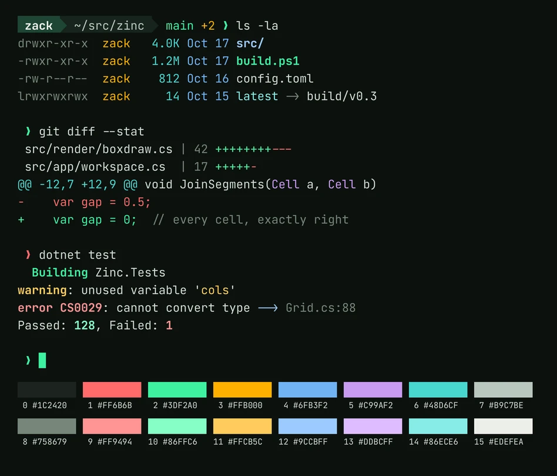

Zinc is a terminal for Windows, built on libghostty, the same terminal core that powers [Ghostty](https://ghostty.org). The core handles the hard parts of being a terminal, like parsing escape sequences, keeping scrollback, and reflowing text. Everything around it, from the window to the settings to every button, is Zinc's own, written as a native WinUI 3 app.

Its tagline is "Every cell, exactly right." It's in public alpha, free, and you can [download it](https://zincterminal.dev/#install) today. The source isn't public yet, but it's on its way under the Apache 2.0 license.

## Where it started

Zinc didn't start out as its own terminal. It started as a way to help bring Ghostty to Windows, so libghostty-vt, Ghostty's terminal core as a C library built from Zig, was the starting point and not a choice made later. What was left to choose was everything around it: the windows, the tabs, the settings, the input, and the language to write them in.

Then two things happened. The Ghostty for Windows effort was paused, and I realized that no terminal on Windows worked the way I wanted while also feeling at home on Windows. After years with modern terminals on macOS and Linux, Windows Terminal and the rest left me a little jealous. So I kept going, with one goal: a terminal that feels native to Windows while still feeling modern.

The first commit landed on September 25, 2026. Testers had their first build a week later, and it's had a steady stream of them since, each with its own changelog.

## Phantom, Phosphor, Zinc

The project went through three names in its first week.

It started as **Phantom**, a nod to Ghostty, since it was meant to be part of Ghostty's story on Windows. Once it became its own terminal, I wanted a name that stood on its own.

The next day it became **Phosphor**, after the glowing coating on the inside of old CRT screens. That's also where the green, lit-cell look came from. The problem was that roughly half the developers I showed it to immediately thought of Phosphor Icons, so the name kept confusing people.

So I took the chemistry one step further. The green phosphor in classic monochrome monitors is copper-doped zinc sulfide, so on October 1 it became **Zinc**. The name carries the same idea without spelling it out. It paid off in a couple of other ways, too. The command-line tool that controls Zinc is `zn`, zinc's chemical symbol. And zinc sulfide is also what makes glow-in-the-dark things glow, which gave me a quiet nod back to where it all started: "Zinc: what makes ghosts glow in the dark."

The icon changed with the name. Honestly, the Phosphor icon was a poor attempt. The Zinc icon took many rounds of refining, and it ended up as a little dot matrix of literally lit cells, which is the perfect fit.

## How it's being built

I'll be upfront that AI is a big part of how Zinc gets built, and that changed a lot over its first few weeks.

As Phantom, it was *very* heavily AI-led with minimal oversight from me. It was firmly in vibe-coding territory, where I vaguely described what I wanted and let it run. Once it became Phosphor, I got a lot more deliberate. I was still prompting, but I was specific about the architecture, the tech, and the design patterns, and I reviewed the code and had Claude iterate on whatever I thought needed changing.

Once it became Zinc, and I knew I wanted it to be public, and to be good, I got much more hands-on. Now I'm at minimum reading, cleaning up, and testing every change before *I* commit it, never the agent. Some changes I write entirely myself, and some I mix, where I start a piece and Claude finishes it, or Claude drafts it and I refine it. The workflow I use for that, with its writing rules and its review steps, came straight out of this project.

The one thing that's been intentional from the very start is the UI and UX. Zinc follows Windows wherever it can, and deviates only where I think the experience can be better. WinUI 3 is already fairly accessible, but Zinc's settings try to go further than Windows' own by improving the way expanders and folds interact with screen readers.

## How it works

Zinc has three main layers, each doing the job it's best at.

- **libghostty** is Ghostty's terminal core, called from C#. It does the parsing, keeps the screen and its scrollback, handles selection, and encodes your keys and mouse for the program you're running.
- **ConPTY** is how Windows runs a shell inside a terminal. Zinc ships the newer ConPTY from Windows Terminal, and falls back to the one built into Windows.
- **Win2D** draws the screen. Each glyph is drawn once into an atlas and then copied into its cell, so every character sits exactly on the grid.

### Every cell, exactly right
Most terminals trust the font to draw box lines, blocks, and Powerline shapes, and most fonts only line up at their default size and spacing. Zinc draws those characters itself, cell by cell, using Ghostty's own sprite drawing. Lines reach the edge of their cells, so they meet their neighbors exactly, even with extra line height, and Powerline prompts work without a patched font.

### Settings that explain themselves
Zinc is configured with a `config.toml` file, but you never have to open it. The Settings window has over a hundred settings, each explained in plain words, with a live preview as you change them. Every change is written to the file right away, touching only that line, and one click undoes everything since you opened the window. If that sounds a lot like [Ghostty Config](/projects/ghostty-config), it's not a coincidence.

### Native to Windows
Zinc looks and behaves like the rest of your desktop. It takes on your wallpaper's tint with Mica on Windows 11, keeps running in the notification area, and has a quick terminal on a global hotkey. It also finds your shells on its own, including PowerShell, Command Prompt, WSL, Git Bash, MSYS2, the Visual Studio developer shells, and even SSH. Panes slide into place when you split, close, or move them, and turn the animations off when Windows' own animation effects are off.

### Built for real work
Workspaces group a project's tabs and splits, and reopen where you left them. Shell integration works with PowerShell, Command Prompt, bash, zsh, fish, nushell, and elvish, and marks each command in the gutter so a failure stands out before you read a line. When something finishes, fails, or needs you while it's out of view, Zinc says so in plain words, like "Tests failed (exit 1) in workspace 2." And the `zn` command line can drive all of it from a script.

## What fought back

Plenty, but not the part I expected. Calling libghostty from C# turned out to be one of the easier pieces. The hard parts were mostly the Windows side.

- **WinUI.** When WinUI fails, it often gives no real diagnostics and no way to recover. Its render loop has bottlenecks of its own, and because it's woven so deeply into Windows, other programs running on the machine can slow it down too.
- **Win2D.** Canvas lifetimes caused terminals to freeze mid-render, with nothing on screen to say why.
- **ConPTY.** The classic ConPTY problems, like delays on large writes and limited throughput.

## Lit Cell

Zinc ships with two color schemes of its own, [Lit Cell](https://zincterminal.dev/lit-cell) and Lit Cell Light. They're built around an old phosphor screen, like the name: a near-black background with a faint green cast, mint phosphor green, warm amber, and soft, readable pastels. The light version keeps the same hues, deepened for a pale background. For the full retro look, Zinc also ships its own shaders, like scanlines, a curved CRT monitor, and a one-color phosphor screen in Lit Cell's green.

They aren't just for Zinc. [Lit Cell's repo](https://github.com/zerebos/lit-cell) has ports for Ghostty, Windows Terminal, Alacritty, kitty, WezTerm, iTerm2, Konsole, foot, and VS Code.
